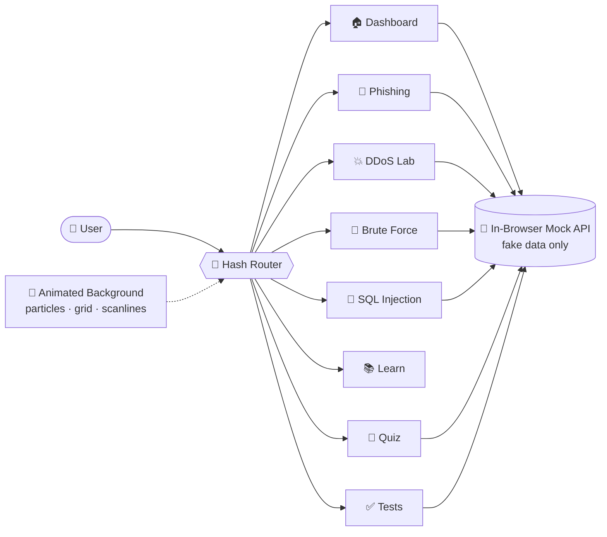

<div align="center">

```
 ██████╗██╗   ██╗██████╗ ███████╗██████╗ ███████╗██╗███╗   ███╗
██╔════╝╚██╗ ██╔╝██╔══██╗██╔════╝██╔══██╗██╔════╝██║████╗ ████║
██║      ╚████╔╝ ██████╔╝█████╗  ██████╔╝███████╗██║██╔████╔██║
██║       ╚██╔╝  ██╔══██╗██╔══╝  ██╔══██╗╚════██║██║██║╚██╔╝██║
╚██████╗   ██║   ██████╔╝███████╗██║  ██║███████║██║██║ ╚═╝ ██║
 ╚═════╝   ╚═╝   ╚═════╝ ╚══════╝╚═╝  ╚═╝╚══════╝╚═╝╚═╝     ╚═╝
                    //  N E X U S   L A B  //
```

### ⚡ Interactive Cyber Defense Hub ⚡
**Explore attack vectors. Understand mechanics. Build unbreakable defenses.**

<br/>


</div>

---

> [!WARNING]
> **🛡️ EDUCATIONAL SIMULATION ONLY. NO REAL SYSTEMS ARE ATTACKED.**
> Every attack in this project is a visual or string-logic simulation running on fake, in-memory data. There is no exploit code, no malware, no port scanning and no external network attack. Never enter real passwords into the demos.

---

## 📡 Table of Contents

- [🧬 About the Project](#-about-the-project)
- [✨ Features](#-features)
- [🎮 Simulation Modules](#-simulation-modules)
- [🧪 Test Suite](#-test-suite)
- [🛠️ Tech Stack](#️-tech-stack)
- [🏗️ Architecture](#️-architecture)
- [🚀 Installation](#-installation)
- [🕹️ How to Use](#️-how-to-use)
- [📁 Project Structure](#-project-structure)
- [🔐 Safety & Ethics](#-safety--ethics)
- [🩹 Troubleshooting](#-troubleshooting)
- [🗺️ Roadmap](#️-roadmap)
- [🤝 Contributing](#-contributing)
- [👤 Author](#-author)
- [📜 License](#-license)

---

## 🧬 About the Project

**CYBERSIM // NEXUS LAB** is a web-based cybersecurity education platform that teaches how common cyber attacks work and how to defend against them. Instead of reading dry theory, you run animated, hands-on simulations of real attack types inside a futuristic "command center" interface.

**Why it exists:** concepts like DDoS, phishing, brute-force and SQL injection are hard to grasp from textbooks alone, and real-world labs can be complex or unsafe for beginners. NEXUS LAB gives you an accessible, visual and **risk-free** way to learn them.

### 🎯 Objectives

| | Objective |
|---|---|
| 🔍 | Show how common cyber attacks work through interactive visual simulations |
| 🛡️ | Teach the matching defenses and show their effect in real time |
| 🎣 | Build awareness of phishing, weak passwords and insecure coding |
| 🧠 | Test understanding with a quiz and an automated test suite |
| 💻 | Demonstrate modern front-end engineering with a polished, high-performance UI |

---

## ✨ Features

- 🌌 **Cinematic HUD interface**: dark sci-fi theme, glassmorphism cards, neon glow, animated particle network, perspective grid and scanlines
- ⚡ **Glitch hero + live counters**: animated title, typewriter text and real-time statistics
- 📟 **Live Threat Feed**: a terminal panel streaming randomly generated fake security events with colour-coded severity
- 🎛️ **FX toggle**: switch heavy visual effects on or off with one click
- 🎨 **Accent switcher**: pick a cyan, green or magenta theme
- 🧭 **Hash-based single-page router**: instant navigation with no page reloads
- 📱 **Fully responsive**: phone to 4K, with a hamburger menu on small screens
- ♿ **Accessibility-minded**: keyboard focus rings, semantic HTML and `prefers-reduced-motion` support
- 🚨 **Global error toasts**: runtime errors appear as HUD notifications instead of a blank screen
- 🧪 **Built-in test runner**: 8 verification cases you can run from inside the app

---

## 🎮 Simulation Modules

| # | Module | Route | What you learn |
|---|--------|-------|----------------|
| 🏠 | **Dashboard** | `#/home` | Overview, live stats and the threat feed |
| 🎣 | **Phishing Awareness** | `#/phishing` | Spot red flags in a fake email and login page: suspicious sender, urgent tone, mismatched links, spelling errors |
| 💥 | **DDoS Lab** | `#/ddos` | Watch bot traffic overwhelm a server, then switch on rate limiting, a WAF and a load balancer to recover |
| 🔑 | **Brute Force** | `#/bruteforce` | See how password length and character set affect crack time through entropy, and how MFA changes the outcome |
| 💉 | **SQL Injection** | `#/sqli` | Compare a vulnerable concatenated query with a secure parameterized query, using fake data only |
| 📚 | **Learn & Defend** | `#/learn` | What each attack is, how it works, real-world impact and a prevention checklist |
| 🧠 | **Quiz** | `#/quiz` | 10 multiple-choice questions with instant feedback and rank titles |
| ✅ | **Test Suite** | `#/tests` | Run all 8 verification cases and see pass/fail results |

### 🏆 Quiz Ranks
Score well to climb from **Script Kiddie** to **Analyst** and finally **Cyber Guardian**.

---

## 🧪 Test Suite

The app ships with **8 test cases**, runnable in the browser at `#/tests` (or via the **Test Suite** link in the navbar, or the **System Health Verification** button on the dashboard).

| Test | Area | Verifies |
|:---:|------|----------|
| 1 | Backend (mock) | App shell loads and shows the title and disclaimer banner |
| 2 | Backend (mock) | Threat feed returns 10 well-formed events with valid severities |
| 3 | Backend (mock) | Brute-force estimate returns numeric results, and longer passwords take strictly longer |
| 4 | Backend (mock) | Invalid brute-force input is rejected with a clear error |
| 5 | Backend (mock) | SQL injection mock: a tautology bypasses vulnerable mode but is blocked in secure mode |
| 6 | Backend (mock) | Quiz returns 10 questions with 4 options each, and scoring is correct |
| 7 | Frontend | Router renders every route and cleans up animation loops on exit |
| 8 | Frontend | DDoS health, phishing score and password strength logic behave as expected |

**Goal: 8 / 8 passing** ✅

---

## 🛠️ Tech Stack

| Layer | Technology |
|-------|------------|
| 🎨 **Styling** | Tailwind CSS, custom CSS animations |
| ⚙️ **Language** | JavaScript / TypeScript |
| 📦 **Build tool** | Vite |
| 🟢 **Runtime** | Node.js (v18 or newer) |
| 🖼️ **Graphics** | HTML5 Canvas (particles and DDoS visualizer), CSS transforms |
| 🔤 **Fonts** | Orbitron, JetBrains Mono, Inter (Google Fonts) |
| 🤖 **Built with** | Google AI Studio |

---

## 🏗️ Architecture



Each page exposes an `init()` and `destroy()` lifecycle so timers, animation frames and listeners are cleaned up when you navigate away. The "backend" runs entirely in the browser through a mocked API layer, so no server is required.

---

## 🚀 Installation

### 📋 Prerequisites

- **Node.js** v18 or newer, from [nodejs.org](https://nodejs.org)
- **npm** (included with Node.js)
- **Git**

Check your versions:

```bash
node -v
npm -v
git --version
```

### ⬇️ Step-by-step

**1️⃣ Clone the repository**

```bash
git clone https://github.com/Aryav-Coder21/CYBERSIM-NEXUS-LAB.git
cd CYBERSIM-NEXUS-LAB
```

**2️⃣ Install dependencies**

```bash
npm install
```

**3️⃣ (Optional) Set up environment variables**

The project includes a `.env.example` file. The simulations run entirely on fake data, so no API key is required for the core app. If you add optional features later, copy the template:

```bash
# macOS / Linux
cp .env.example .env.local

# Windows (PowerShell)
Copy-Item .env.example .env.local
```

**4️⃣ Start the development server**

```bash
npm run dev
```

Then open the address shown in your terminal (usually `http://localhost:3000` or `http://localhost:5173`) in your browser. 🎉

### 📦 Production build

```bash
npm run build      # creates an optimized build in /dist
npm run preview    # serves the production build locally
```

> 💡 Check the `scripts` section of `package.json` for the exact command names in your copy.

---

## 🕹️ How to Use

1. **Launch the lab.** Open the app. The disclaimer banner confirms everything is simulated.
2. **Start on the Dashboard.** Watch the live threat feed and counters. Click **INITIALIZE SIMULATION** to jump into the lab modules.
3. **Pick a module** from the navbar or the module cards and follow the on-screen instructions:

   | Module | Try this |
   |--------|----------|
   | 🎣 **Phishing** | Click every suspicious element in the fake email. Your score and the explanations appear as you go. |
   | 💥 **DDoS Lab** | Raise the **intensity** and **bot count** sliders and press start. Watch the server health gauge drop, then enable **rate limiting**, **firewall/WAF** and **load balancer** one by one to see the recovery. |
   | 🔑 **Brute Force** | Type a *sample* password (never a real one) and watch the estimated crack time. Compare short and long passwords, and toggle MFA. |
   | 💉 **SQL Injection** | Enter a classic tautology input in **Vulnerable mode** to see how the concatenated query gets bypassed. Switch to **Secure mode** to see the parameterized query block it. |
   | 📚 **Learn** | Read the defense checklist for each attack. |
   | 🧠 **Quiz** | Answer 10 questions, read the explanations and earn your rank. |

4. **Customize the look.** Use the **FX: ON/OFF** button to toggle heavy effects, and the three colour dots to switch the accent theme.
5. **Verify everything.** Open **TEST SUITE** (`#/tests`) and run the verification to see all 8 test cases pass.

### 🧭 Direct links

Append the route to your local address, for example `http://localhost:3000/#/ddos`.

```
#/home   #/phishing   #/ddos   #/bruteforce   #/sqli   #/learn   #/quiz   #/tests
```

---

## 📁 Project Structure

```
CYBERSIM-NEXUS-LAB/
├── 📂 src/              # Application source (pages, router, mock API, background, utils)
├── 📄 index.html        # App entry point
├── 📄 package.json      # Scripts and dependencies
├── 📄 vite.config.ts    # Vite configuration
├── 📄 tsconfig.json     # TypeScript configuration
├── 📄 metadata.json     # Project metadata
├── 📄 .env.example      # Environment variable template
├── 📄 .gitignore        # Git ignore rules
└── 📄 README.md         # You are here
```

---

## 🔐 Safety & Ethics

This project is built strictly for **learning and awareness**.

- ✅ All attacks are visual animations or pure string-logic simulations
- ✅ All users, queries, traffic and events are fake and generated in memory
- ✅ Passwords typed into the demos are never stored, logged or transmitted
- ❌ No real exploit payloads, malware or credential harvesting
- ❌ No port scanning or requests to external targets

**Do not use the concepts shown here against systems you do not own or have explicit written permission to test.** Unauthorized access to computer systems is illegal.

---

## 🩹 Troubleshooting

| Problem | Fix |
|---------|-----|
| `npm install` fails | Make sure Node.js is v18+, delete `node_modules` and `package-lock.json`, then run `npm install` again |
| Blank content area | Open the browser console (`F12`) and check for errors. Visit `/#/home` to reset the route. |
| Port already in use | Stop the other process, or run `npm run dev -- --port 4000` |
| Animations feel slow | Click **FX: ON** to turn effects off, or enable "reduce motion" in your OS |
| Fonts look wrong | Check your internet connection, since fonts load from Google Fonts |

---

## 🗺️ Roadmap

- [x] Dashboard with live threat feed
- [x] Phishing, DDoS, brute-force and SQL injection simulators
- [x] Quiz with rank titles
- [x] In-browser test suite (8 cases)
- [ ] Add more attacks (XSS, ransomware, man-in-the-middle)
- [ ] Persistent high scores and user profiles
- [ ] Multi-language support
- [ ] Sound-free micro-interaction polish and extra themes
- [ ] Guided "learning path" mode

---

## 🤝 Contributing

Contributions, ideas and bug reports are welcome!

1. 🍴 Fork the repository
2. 🌿 Create a branch: `git checkout -b feature/amazing-idea`
3. 💾 Commit your changes: `git commit -m "feat: add amazing idea"`
4. 📤 Push the branch: `git push origin feature/amazing-idea`
5. 🔃 Open a Pull Request

Please keep every new simulation **safe, fake-data-only and educational**.

---

## 👤 Author

<div align="center">

**Aryav Varshney**

[](https://github.com/Aryav-Coder21)

*Built as a college project to make cybersecurity visual, interactive and safe to learn.*

</div>

---

## 📜 License

This project is licensed under the **MIT License**. Add a `LICENSE` file to the repository root to make it official.

---

<div align="center">

```
> SYSTEM STATUS: ONLINE
> THREATS MITIGATED: ∞
> STAY CURIOUS. STAY SECURE.
```

⭐ **If this project helped you learn, give it a star!** ⭐

</div>
